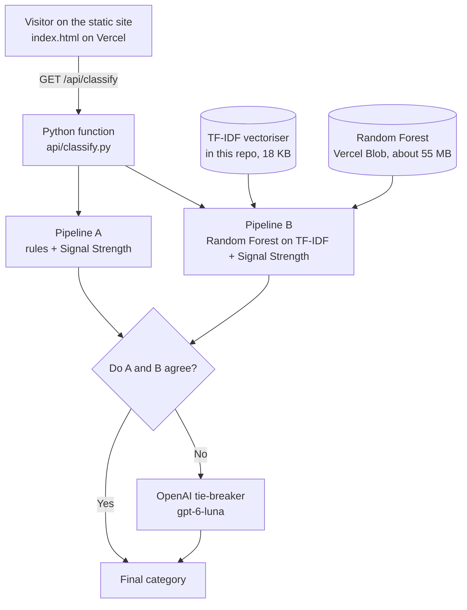

# Mila's Little Shop and the CELM classifier

The website for the *Adventures of Mila* children's books, with a live demo of **CELM**, a classifier that sorts a children's book title into one of five metadata categories. CELM comes from my Master's research at AUT on cross-market book metadata.

**Live site:** https://milas-little-shop.vercel.app

## What CELM does

Give it a book title and a market (USA, UK, NZ, AU, PH, JP or CN). It returns one category:

| ID | Category | What it means |
|---|---|---|
| `[EDU_01]` | Grade-Specific | The title names a school grade or year, such as "Year 2" or "1st Grade" |
| `[TOP_02]` | Topic-Specific | The title is about a subject, such as geography, science or maths |
| `[EMO_03]` | Emotive | The title is about feelings and themes such as belonging, friendship or courage |
| `[BRD_04]` | Brand-Specific | The title names a known brand or author, such as Mila or Bluey |
| `[GEN_05]` | General | General children's content that fits none of the above |

## How it works

Two classifiers look at every title. If they agree, that is the answer. If they disagree, a language model makes the final call.



- **Pipeline A (rules).** Looks for signal words in the title, such as grade terms for the chosen market, topic words, emotion words and brand names. It also gives a Signal Strength score from 1 to 10.
- **Pipeline B (Random Forest).** A model trained on Amazon titles, using TF-IDF text features plus the Signal Strength score.
- **Tie-breaker.** Only when A and B disagree, a language model chooses between their answers (or a different category if neither fits), using the category definitions as its prompt.
- **If the language model is unavailable,** the rule-based answer is used and the response says so (`llm_status`).

## Try the API

```
GET /api/classify?title=<book title>&country=<USA|UK|NZ|AU|PH|JP|CN>
```

Encode the title for a web address. In JavaScript, use `encodeURIComponent`. A title with `&` in it needs `%26`.

Example: `/api/classify?title=Year%202%20Reading%20Workbook&country=USA`

```json
{
  "title": "Year 2 Reading Workbook",
  "country": "USA",
  "final_uid": "[EDU_01]",
  "final_label": "Grade-Specific",
  "pipeline_a_label": "General",
  "pipeline_b_label": "Topic-Specific",
  "signal_strength": 1,
  "agreed": false,
  "llm_status": "ok",
  "explanation": "The pipelines disagreed, so a language model made the final call."
}
```

`llm_status` is `not_needed` when A and B agree, `ok` when the language model answered, and `error`, `invalid_response` or `not_configured` when the rules answer was used instead.

## How well does it work?

These are research results, not guarantees for new titles.

| Setup | Accuracy | Macro F1 |
|---|---|---|
| Hybrid with Amazon Nova Lite (research result) | 77.41% | 0.5022 |
| Hybrid with `gpt-6-luna` (this site) | 76.14% | 0.4875 |

Both figures use titles from Google Books markets that the model was not trained on, with the labels as first recorded, and with titles that repeat across markets removed (1,421 titles).

What I learned from the testing:

- A model that scored 93.19% on its own source (Amazon) scored 16.30% on another (Google). This is why the hybrid and the cross-source testing matter.
- The language model helps most with Grade-Specific titles and sometimes gets Topic-Specific and General titles wrong, so it is not always better than the rules.
- Brand-Specific is the weakest category.
- The reviewed labels came from one reviewer, so a second independent reviewer would strengthen them.

## Repository layout

```
index.html                         the website (static)
api/classify.py                    the Python function (rules, model, tie-breaker)
model/celm_tfidf_vectorizer.joblib the saved TF-IDF vectoriser
model/celm_label_encoder.joblib    label order for the Random Forest (if used)
requirements.txt                   Python packages, pinned to the training versions
```

The Random Forest file (about 55 MB) is not in the repo. It is stored in **Vercel Blob** as a private file and downloaded the first time the function runs.

## Configuration

Set these in the Vercel project settings (**Settings → Environment Variables**). Never put keys in the code or in this repository.

| Variable | Purpose |
|---|---|
| `CELM_OPENAI_KEY` | OpenAI API key for the tie-breaker |
| `CELM_OPENAI_MODEL` | Model name, `gpt-6-luna` |
| `BLOB_READ_WRITE_TOKEN` | Lets the function download the Random Forest from Vercel Blob |

Notes:

- The first request after a quiet period can take a few seconds while the model loads.
- scikit-learn must be the same version used for training, or the saved model can fail to load.
- Because the endpoint is public and each disagreement costs a model call, keep a spending limit on the OpenAI account.

## Limitations

- The five categories and the rules are designed for children's book titles and these seven markets.
- Results are suggestions for metadata, not final labels.
- The classifier reads only the title. It does not see the description or the cover.

## About

Built by Arlen Balunan. The CELM method comes from a Master's research project at Auckland University of Technology (2026).
